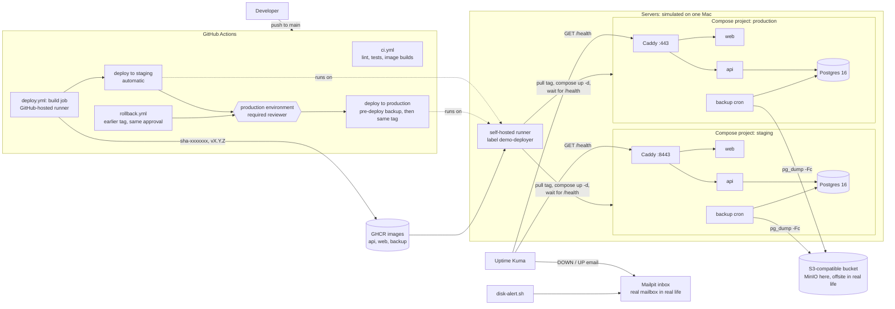

# deploy-pipeline-demo

A small, working demonstration of a production setup for a React + Node.js + PostgreSQL appointment app:

- **Two environments:** staging and production.
- **Deployments:** through GitHub Actions, with a manually approved production release.
- **Running:** HTTPS, automatic restarts and access controls.
- **Data:** daily PostgreSQL backups with retention, plus a tested restore into staging.
- **Monitoring:** alerts for uptime, disk space and app failures.
- **Rollback:** a demonstrated one-click rollback.

Everything here was run and checked on one machine. Every result is logged in [`verification.md`](verification.md), with the raw output in [`evidence/`](evidence/).

> In this demo the two servers are simulated as separate Compose projects on one machine. On your setup they are two separate cloud servers, and the deploy step connects over SSH.

## What it shows

| Area | What is in the repo | Proof |
|---|---|---|
| Staging + production | One `deploy/compose.yml`, run as two projects (`-p staging`, `-p production`) with their own database volume, ports and env file | `verification.md` rows 6 to 9 |
| CI | `.github/workflows/ci.yml`: install, lint, API tests against a Postgres 16 service container, image builds, on every push and PR | row 4 |
| CD with approval | `.github/workflows/deploy.yml`: build once, push to GHCR as `sha-<commit>` and `v<version>`, deploy to staging automatically, then production waits for a reviewer and deploys **the same image tag** (it never rebuilds) | rows 5 to 9, 22 to 24 |
| HTTPS | Caddy in front of each stack (`tls internal` here; Let's Encrypt automatically on real domains, same Caddyfile) | row 9 |
| Restarts | `restart: unless-stopped` on every service, healthchecks in every image, api waits for a healthy database | row 17 |
| Access control | Non-root images, dropped capabilities, no database port published, per-environment secrets, least-privilege backup users; server hardening runbook | rows 3, 13; [docs/SERVER-HARDENING.md](docs/SERVER-HARDENING.md) |
| Backups | `pg_dump -Fc` daily by cron in a `backup` sidecar, to S3-compatible storage, 7 daily + 4 weekly retention, a backup before every production deploy | rows 10 to 14, 23 |
| Restore | `scripts/restore-to-staging.sh`: restores a production backup into staging, checks row counts and `/health`, prints the time taken | row 15 |
| Monitoring | Uptime Kuma checks `/health` on both environments and emails DOWN/UP; `scripts/disk-alert.sh` emails on high disk use | rows 16 to 21 |
| Rollback | `.github/workflows/rollback.yml`: redeploys an earlier tag behind the same approval; no rebuild, no database change | rows 25 to 29; [docs/ROLLBACK.md](docs/ROLLBACK.md) |

## Architecture



## What is simulated and how it maps to real servers

| In this demo | On your setup |
|---|---|
| Staging and production are two Compose projects on one Mac (`-p staging`, `-p production`) | Two cloud servers, each running the same `deploy/compose.yml` |
| Deploy jobs run on a self-hosted GitHub runner on that Mac (label `demo-deployer`) and call `deploy/deploy.sh` directly | Deploy jobs run on GitHub-hosted runners and call `deploy/remote-deploy.sh`, which connects over SSH as a restricted `deploy` user and runs the same `deploy/deploy.sh` on the server (*for real servers, not run in this demo*) |
| `staging.localhost` and `app.localhost` with `tls internal` (Caddy's own certificate authority) | Real domains; Caddy gets and renews Let's Encrypt certificates automatically from the same Caddyfile (`CADDY_TLS` left empty) |
| MinIO container (community build `pgsty/minio`; the upstream images are no longer published) as the offsite bucket | The provider's object storage (S3, R2, B2, Spaces), ideally in another region, with versioning or object lock |
| Mailpit, a local inbox, receives the alerts | A real mailbox or chat integration (Kuma supports email, Slack, Teams, Telegram and more) |
| Firewall, SSH hardening, fail2ban, unattended upgrades | Applied on each server from [docs/SERVER-HARDENING.md](docs/SERVER-HARDENING.md) (*documented, not run in this demo*) |

## Run it yourself

You need Docker with Compose v2, Node 20+, `gh`, `curl`, `jq` and `openssl`.

```bash
# 1. Offsite bucket (stand-in for S3)
cp deploy/offsite/.env.example deploy/offsite/.env            # add MINIO_ROOT_PASSWORD
docker compose -p offsite --env-file deploy/offsite/.env -f deploy/offsite/compose.yml up -d --wait
STAGING_S3_SECRET=... PRODUCTION_S3_SECRET=... deploy/offsite/setup.sh

# 2. An environment, from a tag already in GHCR
export IMAGE_PREFIX=ghcr.io/<owner>/deploy-pipeline-demo
POSTGRES_PASSWORD=... S3_SECRET_KEY=... deploy/write-env.sh staging
deploy/deploy.sh staging v1.0.0                                # https://staging.localhost:8443

# 3. Monitoring
cp monitoring/.env.example monitoring/.env                      # fill in
docker compose -p monitoring -f monitoring/compose.yml up -d
(cd monitoring && npm ci && node kuma-setup.mjs)               # Kuma on http://127.0.0.1:3001

# Day-to-day
scripts/compose.sh production exec backup /backup.sh           # backup now
scripts/restore-to-staging.sh production_daily_<timestamp>.dump
scripts/disk-alert.sh 80 /
gh workflow run rollback.yml -f tag=v1.0.0                      # then approve in GitHub
```

For the pipeline, create the `staging` and `production` environments, with a required reviewer on production. Add the secrets `POSTGRES_PASSWORD` and `S3_SECRET_KEY` to each, and register a runner labelled `demo-deployer`.

## Repository layout

| Path | Contents |
|---|---|
| `api/` | Express API: `GET /health`, `GET/POST /api/appointments`, one migration, a 25-row seed, tests |
| `web/` | React (Vite) page, built to static files and served by Caddy; version in the footer |
| `deploy/` | Compose file, Caddyfile, env templates, deploy, pre-deploy backup and SSH deploy scripts, backup image, offsite bucket |
| `monitoring/` | Uptime Kuma + Mailpit Compose project and the Kuma setup script |
| `scripts/` | restore to staging, retention test, disk alert, compose wrapper, evidence helpers |
| `docs/` | [ENVIRONMENT](docs/ENVIRONMENT.md), [ROLLBACK](docs/ROLLBACK.md), [SERVER-HARDENING](docs/SERVER-HARDENING.md), [MIGRATION-PLAN](docs/MIGRATION-PLAN.md) |
| `evidence/` | Logs and screenshots from the runs, numbered; referenced from `verification.md` |
| `pdf/` | Source of the evidence PDF and the screenshot script |

## Security notes

- **No secrets in git.** The values live in GitHub environment secrets and in env files outside the repository, with mode 600. Every commit was preceded by a secret scan.
- **The self-hosted runner is for this demo only.** Workflows from forks require approval, and only `main` can deploy to production. With real servers, deploys use GitHub-hosted runners and SSH.
